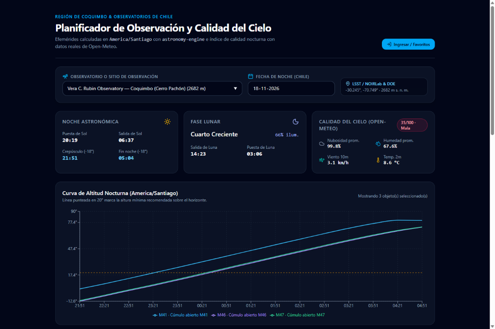

# Planificador de Observación y Calidad del Cielo

Aplicación web full-stack diseñada para planificar sesiones de observación astronómica en la Región de Coquimbo y los principales observatorios y proyectos de Chile. Calcula efemérides reales (`astronomy-engine`), curvas de altitud nocturna en zona horaria `America/Santiago` y un índice de calidad del cielo (0–100) a partir de datos meteorológicos reales de Open-Meteo.



## Problema que resuelve

Coordinar una noche de observación requiere cruzar efemérides (crepúsculo astronómico a `-18°`, fase lunar, ventanas de visibilidad sobre `20°` de altura) con condiciones atmosféricas locales (nubosidad, humedad, viento y temperatura), evitando errores de conversión UTC / `America/Santiago` (incluyendo cambios de horario DST).

## Sitios astronómicos incluidos (10 ubicaciones en Chile)

- **Región de Coquimbo:** Vera C. Rubin Observatory (LSST), Gemini South & SOAR (Cerro Pachón), Cerro Tololo (CTIO), Observatorio La Silla (ESO) y La Serena (Base AURA/NOIRLab).
- **Atacama y Norte Grande:** Las Campanas & Giant Magellan Telescope (GMT), Paranal (VLT), Cerro Armazones (ELT), ALMA (Llano de Chajnantor) y CTAO-South.

## Arquitectura y decisiones técnicas

- **Monolito modular en Next.js (App Router) + TypeScript `strict`:**
  - `src/lib/astro/` y `src/lib/weather/` contienen lógica de dominio pura y determinista, desacoplada de React y HTTP (cobertura > 95% en cálculos).
  - `src/app/api/` actúa como frontera delgada validada con **Zod**.
- **Manejo estricto de zona horaria (`America/Santiago`):** Ventanas nocturnas de 24h (`12:00` a `12:00` local) calculadas con `Intl.DateTimeFormat` y probadas en transiciones DST.
- **Resiliencia con Open-Meteo:** `fetch` con `AbortController` (timeout configurable), reintentos acotados con backoff exponencial, caché en memoria y **degradación controlada** (si Open-Meteo falla, la app muestra todas las efemérides y avisa del estado meteorológico).
- **Autenticación y favoritos:** Registro/login con `bcryptjs` + JWT HMAC-SHA256 (`jose`) en cookie `HttpOnly`, respaldado por PostgreSQL serverless con migraciones SQL versionadas reversibles (`db/migrations/0001_init.up.sql` y `.down.sql`).

## Fórmula del Índice de Calidad de Observación (0–100)

El índice nocturno evalúa las horas entre las `19:00` y las `06:00` (`America/Santiago`) mediante cuatro subíndices acotados en `[0, 100]`:

- **Nubosidad (`55%`):** $\text{cloudScore} = \text{clamp}(100 - \text{cloudCover} \times 1.1,\, 0,\, 100)$
- **Humedad relativa (`20%`):** $100$ si $\text{humidity} \le 40\%$; si no, $\text{clamp}(100 - \frac{\text{humidity} - 40}{55} \times 100,\, 0,\, 100)$
- **Viento a 10 m (`15%`):** $100$ si $\text{wind} \le 15\text{ km/h}$; si no, $\text{clamp}(100 - \frac{\text{wind} - 15}{40} \times 100,\, 0,\, 100)$
- **Estabilidad térmica (`10%`):** $100$ entre $2\,^\circ\text{C}$ y $18\,^\circ\text{C}$; penaliza $5\text{ pts}/^\circ\text{C}$ fuera de ese rango.

$$\text{Índice} = \text{round}(0.55 \cdot \text{cloudScore} + 0.20 \cdot \text{humidityScore} + 0.15 \cdot \text{windScore} + 0.10 \cdot \text{thermalScore})$$

Clasificación: **80–100** Excelente · **60–79** Buena · **40–59** Regular · **0–39** Mala.

## Cómo ejecutar en local

1. Instalar dependencias:
   ```bash
   npm ci
   ```
2. Configurar variables de entorno:
   ```bash
   cp .env.example .env.local
   ```
   _(Para habilitar cuentas y favoritos en local/producción, configura `DATABASE_URL` y `AUTH_SECRET` y ejecuta `db/migrations/0001_init.up.sql` en tu PostgreSQL)._
3. Levantar en desarrollo:
   ```bash
   npm run dev
   ```
4. Ejecutar suite completa de calidad y pruebas:
   ```bash
   npm run format:check
   npm run lint
   npm run typecheck
   npm run test:coverage
   npm run build
   ```

## Despliegue en Vercel

1. Importar el repositorio en Vercel (`Framework Preset: Next.js`).
2. Configurar las variables de entorno en Vercel:
   - `OPEN_METEO_BASE_URL=https://api.open-meteo.com/v1`
   - `EXTERNAL_API_TIMEOUT_MS=5000`
   - `DATABASE_URL` (PostgreSQL en Neon / Supabase)
   - `AUTH_SECRET` (cadena aleatoria de al menos 32 caracteres)
3. Aplicar la migración inicial `db/migrations/0001_init.up.sql` en la base de datos.

## Documentación de ingeniería

- [ADR-0001: Arquitectura y Stack](./docs/adr/0001-arquitectura-y-stack.md)
- [ADR-0002: Autenticación y Persistencia](./docs/adr/0002-auth-y-persistencia.md)
- [Requisitos y Trazabilidad](./docs/REQUIREMENTS.md)
- [Registro de Riesgos](./docs/RISKS.md)
- [Bitácora de Desarrollo](./docs/worklog/2026-11-18.md)
- [Changelog](./CHANGELOG.md)
